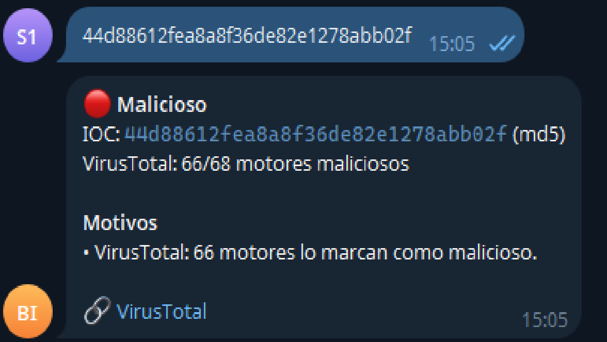
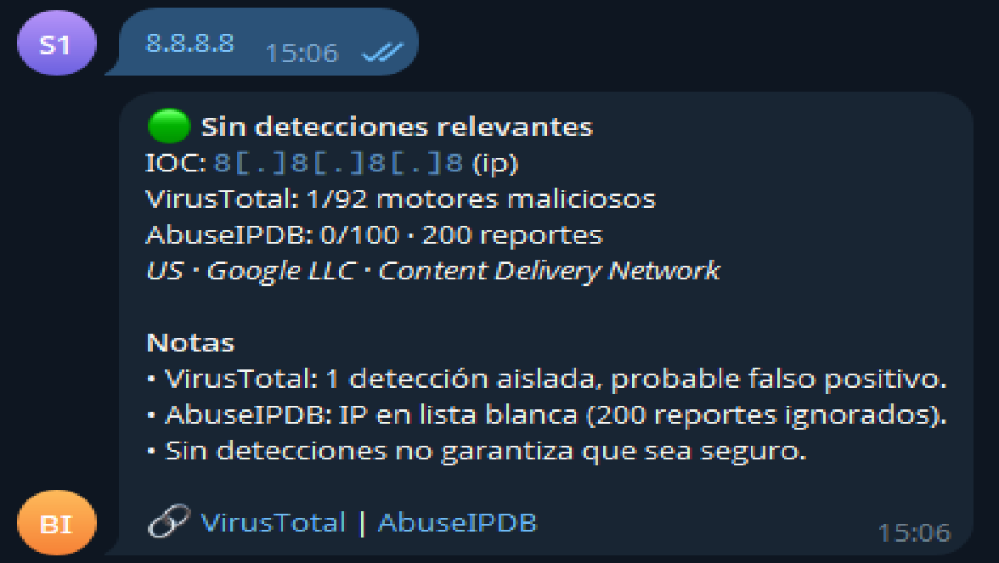
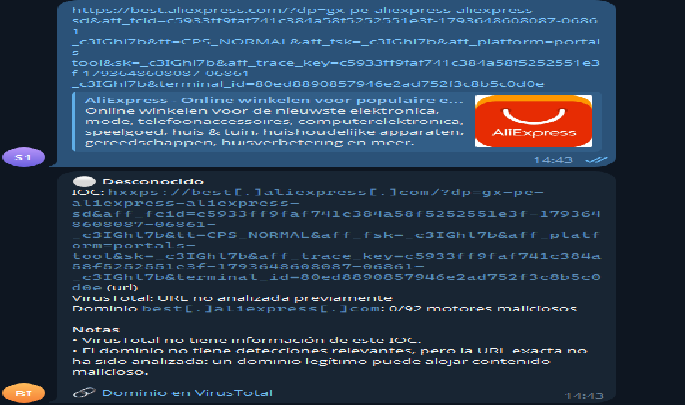

# IOC Triage Bot

Bot de Telegram para el **triage rápido de indicadores de compromiso (IOCs)**. Envías una IP, un dominio, una URL o un hash y recibes en segundos un veredicto con evidencia de **VirusTotal** y **AbuseIPDB**, sin abrir varias webs.

Proyecto personal de portafolio orientado a tareas de **SOC Nivel 1**: enriquecimiento de IOCs, triage y manejo de falsos positivos.

<p align="center">
  
  
  
</p>

---

## Qué hace

- Detecta automáticamente el tipo de IOC: **IPv4/IPv6, dominio, URL, MD5, SHA1, SHA256**.
- Acepta IOCs **neutralizados** (`hxxp://malo[.]com`) y responde siempre neutralizado, para evitar clics accidentales.
- Consulta **VirusTotal** (todos los tipos) y **AbuseIPDB** (solo IPs).
- Emite un veredicto con **reglas explícitas**: 🔴 Malicioso · 🟠 Sospechoso · 🟢 Sin detecciones relevantes · ⚪ Desconocido.
- Si una URL nunca fue analizada, consulta su **dominio** como contexto.
- **Caché** en SQLite para no gastar cuota de las APIs, e **historial** de consultas (`/historial`).
- No consulta IPs privadas o reservadas (`10.x`, `192.168.x`, `127.x`…), porque no tienen reputación pública.

## Arquitectura

```
Mensaje de Telegram
  └─ ¿chat_id autorizado?  ── no → se ignora y se registra en el log
      └─ parser: refang + detección de tipo + normalización
          └─ ¿IP privada?  ── sí → no se consulta
              └─ ¿en caché?  ── sí → resultado guardado
                  └─ VirusTotal (+ AbuseIPDB si es IP)
                      └─ ¿URL desconocida? → consulta del dominio
                          └─ reglas de veredicto → caché + historial → respuesta
```

| Módulo | Responsabilidad |
|---|---|
| `ioc/parser.py` | Refang/defang, detección y validación del tipo de IOC |
| `ioc/sources.py` | Clientes de VirusTotal (API v3) y AbuseIPDB (API v2), con control de ritmo |
| `ioc/verdict.py` | Reglas de veredicto y sus umbrales |
| `ioc/cache.py` | Caché con TTL e historial (SQLite) |
| `ioc/service.py` | Orquesta el flujo completo; no depende de Telegram |
| `ioc/formatter.py` | Construye la respuesta (HTML escapado, IOCs neutralizados) |
| `bot.py` | Capa de Telegram: comandos, lista blanca, logging |
| `consulta.py` | Misma lógica desde la consola, útil para depurar |

La lógica (`service.py`) está separada de la interfaz (`bot.py`). Por eso puede probarse sin Telegram ni internet.

## Reglas de veredicto

Cada fuente da su veredicto y **gana el más grave**.

| Veredicto | Condición |
|---|---|
| 🔴 Malicioso | VirusTotal ≥ 3 motores **o** AbuseIPDB ≥ 51 (si la IP no está en lista blanca) |
| 🟠 Sospechoso | VirusTotal = 2 motores **o** AbuseIPDB entre 25 y 50 |
| 🟢 Sin detecciones relevantes | El resto. Una detección aislada se muestra como nota. |
| ⚪ Desconocido | VirusTotal no conoce el IOC |

**Estos umbrales son una decisión de diseño, no un estándar de la industria.** Están en constantes al inicio de `ioc/verdict.py` para poder ajustarlos.

- **AbuseIPDB ≥ 51 = malicioso:** se priorizó la sensibilidad, porque es una herramienta de *triage* con un analista revisando, no un bloqueo automático. El costo aceptado es más falsos positivos en IPs compartidas o reutilizadas (VPN, hosting, CGNAT de operadoras móviles).
- **"Sin detecciones" no significa "seguro":** el bot lo indica explícitamente en cada respuesta limpia.

## Calibración con datos reales

Las reglas se ajustaron después de observar respuestas reales de las APIs:

| Caso | Observación | Decisión |
|---|---|---|
| `google.com` y `8.8.8.8` | **1 motor** de VirusTotal los marcaba como maliciosos | La regla inicial ("1 o 2 motores = sospechoso") generaba **falsos positivos en sitios legítimos**. Con más de 90 motores, una detección aislada es ruido: ahora se muestra como nota y no cambia el veredicto. |
| `8.8.8.8` | **200 reportes** en AbuseIPDB, pero puntuación 0 y en lista blanca | El número de reportes no es un buen indicador por sí solo; se usa la puntuación y se respeta la lista blanca. |
| Archivo de prueba EICAR | 60 detecciones un día y 66 al siguiente | La reputación cambia con el tiempo, así que la caché caduca (TTL de 24 h). |
| Enlace de afiliado de AliExpress | VirusTotal respondió 404. Al compartir el mismo producto dos veces se generaron parámetros de rastreo distintos (`aff_trace_key`), es decir, cada URL es única. | Antes de cambiar código se verificó la hipótesis: la API reconocía `http://google.com` con y sin barra final, así que el identificador de URL era correcto. Se añadió la **consulta del dominio como contexto** y un **TTL de 1 h para los resultados desconocidos**. |

Sobre la consulta del dominio: un dominio limpio **no** hace limpia a la URL, porque un dominio legítimo puede alojar phishing. Por eso el dominio solo **sube** el veredicto (si tiene 2 o más detecciones), nunca lo baja.

## Decisiones de seguridad

| Medida | Motivo |
|---|---|
| Lista blanca de `chat_id` | Solo los usuarios autorizados pueden usar el bot y gastar la cuota de las APIs. A los desconocidos no se les responde (no se confirma que el bot existe), pero quedan registrados en el log. |
| Respuestas sin vista previa de enlaces | Con la vista previa activa, los servidores de Telegram visitarían la URL analizada, lo que puede alertar al atacante o activar el enlace. |
| IOCs neutralizados en la salida | Evita clics accidentales en enlaces maliciosos dentro del chat |
| Escapado HTML de todo el texto externo | Los datos de las APIs (ISP, etc.) no pueden alterar el formato del mensaje |
| Token fuera de los logs | `httpx` registra las URLs, y la de Telegram contiene el token; ese logger se silencia. |
| Secretos en `.env` (excluido de Git) | En el repo solo hay un `.env.example` sin valores |
| Consultas SQL parametrizadas | Evitan inyección SQL; hay un test que lo comprueba |
| Solo consulta de hashes, nunca subida de archivos | Lo que se sube a VirusTotal queda disponible para su comunidad |
| No se envían URLs desconocidas a analizar | Esa URL quedaría compartida, y puede contener parámetros que identifican a una persona. |
| Polling, no webhook | No se expone ningún puerto a internet |

## Control de cuota

La API pública de VirusTotal permite 4 consultas por minuto y 500 al día; la cuenta gratuita de AbuseIPDB, 1000 consultas al día. Por eso:

- Un `RateLimiter` frena **antes** de llamar a VirusTotal si ya se hicieron 4 consultas en el último minuto.
- La caché evita repetir consultas.
- Los errores (por ejemplo, el límite alcanzado) **no** se guardan en caché.
- Si una fuente falla, el veredicto se calcula con la otra y se muestra el error.

## Instalación

Requisitos: Python 3.10 o superior, un bot creado con [@BotFather](https://t.me/BotFather) y claves gratuitas de [VirusTotal](https://www.virustotal.com) y [AbuseIPDB](https://www.abuseipdb.com).

```bash
git clone https://github.com/Jait-123/ioc-triage-bot.git
cd ioc-triage-bot
python -m venv .venv
# Windows (cmd):  .venv\Scripts\activate.bat
# Linux/macOS:    source .venv/bin/activate
pip install -r requirements.txt
```

Copia `.env.example` como `.env` y completa los valores:

```
TELEGRAM_TOKEN=
VT_API_KEY=
ABUSEIPDB_API_KEY=
ALLOWED_CHAT_IDS=        # uno o varios, separados por comas
```

Comprueba la configuración (muestra solo la longitud de cada valor, nunca el valor) y arranca el bot:

```bash
python check_env.py
python bot.py
```

Para probar sin Telegram: `python consulta.py <IOC>`.

## Tests

```bash
python -m pytest -q
```

69 tests, todos **sin internet**: las APIs se simulan con `httpx.MockTransport` y con clientes falsos, así que se prueban casos difíciles de provocar (límite alcanzado, clave inválida, caídas) sin gastar cuota. Varios casos usan respuestas reales observadas durante la calibración.

## Limitaciones

- Un IOC por mensaje.
- Solo dos fuentes; el veredicto depende de su cobertura.
- Pensado para un usuario o un equipo pequeño: SQLite y la cuota gratuita de las APIs no escalan a volumen de SOC real.
- Corre en polling desde un equipo propio; no hay despliegue continuo.
- La API pública de VirusTotal no puede usarse en productos ni flujos comerciales; este proyecto es personal y educativo.

## Próximos pasos

- Varios IOCs por mensaje, por ejemplo extraídos de un correo sospechoso.
- Más fuentes: abuse.ch (URLhaus, MalwareBazaar) y AlienVault OTX.
- Despliegue en Docker dentro de una VM de laboratorio.
- Integrarlo como canal de alertas de un SIEM de laboratorio (Wazuh).

## Autor

Luis Santa Cruz, estudiante de Ingeniería de Sistemas Computacionales (UPN, Lima).
